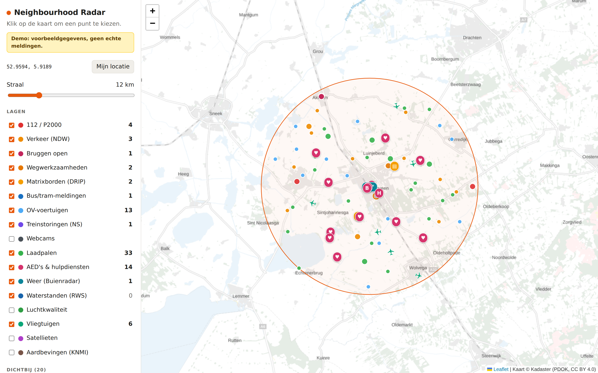
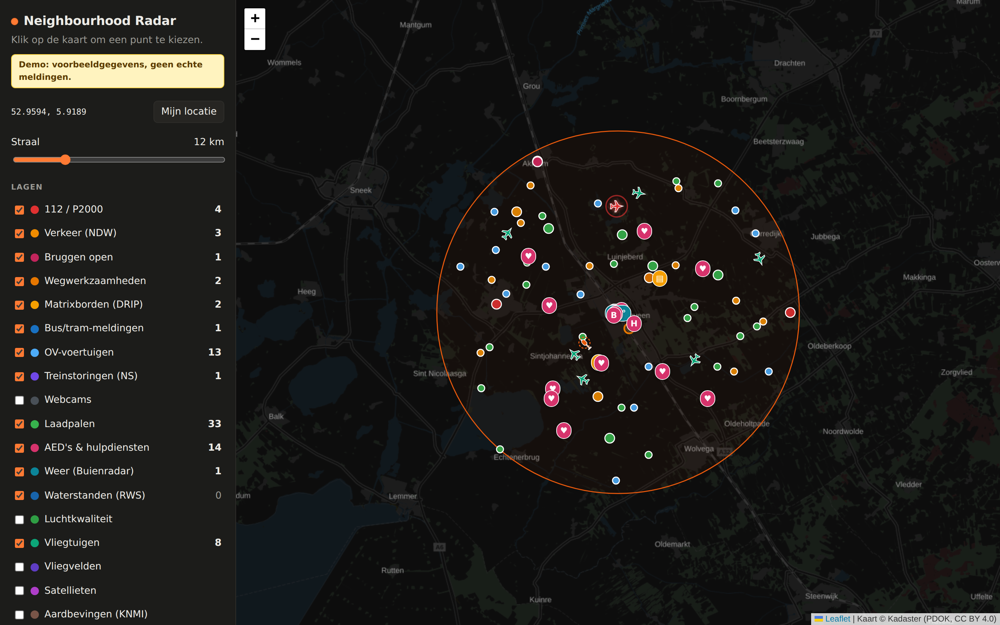
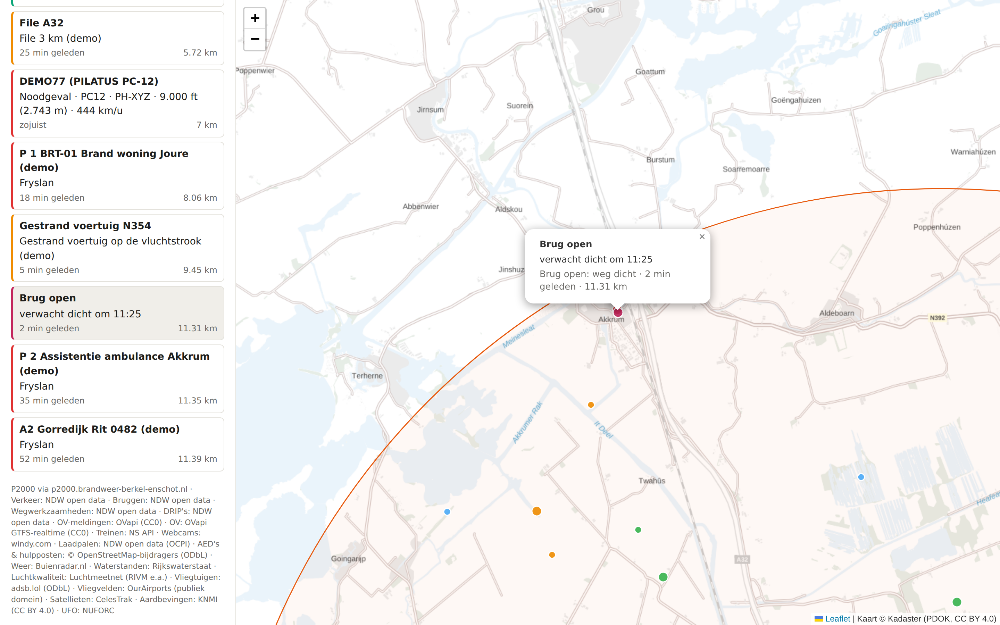
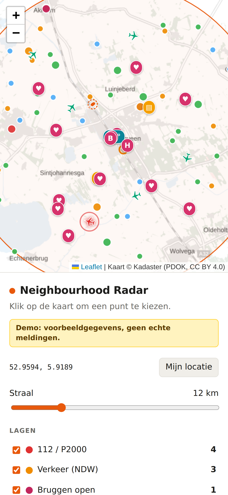

# Neighbourhood Radar

One map with live open data around a point you choose: 112/P2000 alerts, road
incidents, open bridges, roadworks, what the road signs say, buses and trains on
the move, EV chargers, AEDs, weather, water levels, air quality, aircraft,
satellites and earthquakes. Click the map, set a radius, and the side panel lists
what's happening nearby, nearest first.

Inspired by the "KW Live" demo from Kitchener (CTV News, Oct 2026), rebuilt
from scratch for the Netherlands with Dutch open data. Defaults to Heerenveen /
the three northern provinces; everything is configurable.

## Screenshots



| Dark mode | Popup | Phone |
|---|---|---|
|  |  |  |

These show **demo mode** with made-up sample data (no real 112 messages). The
screenshots are regenerated by the `screenshots` workflow after every release.

### Try the demo

```bash
docker run --rm -p 8080:8080 -e OL_DEMO=1 ghcr.io/jwklijnsma/neighbourhood-radar:latest
# open http://localhost:8080
```

`OL_DEMO=1` answers every upstream request from built-in sample data, so it
works offline and needs no keys. The page shows a yellow "Demo" banner.

## Layers

| Layer | Source | Key needed | Refresh |
|---|---|---|---|
| `p2000` – 112 alerts | P2000 RSS from p2000.brandweer-berkel-enschot.nl (same feed as the Home Assistant P2000 component) | no | 30 s |
| `traffic` – accidents, queues, obstructions | NDW open data `actueel_beeld.xml.gz` (DATEX II) | no | 60 s |
| `bridges` – bridges open right now, and openings in the next 6 h | NDW `tijdelijke_verkeersmaatregelen_afsluitingen` (live) + `planningsfeed_brugopeningen` | no | 30 s |
| `roadworks` – roadworks and events, now or in the next 24 h | NDW `planningsfeed_wegwerkzaamheden_en_evenementen` | no | 15 min |
| `drips` – what the dynamic route signs above the road show now (text, or the sign image) | NDW `dynamische_route_informatie_paneel` (DATEX II VMS) | no | 60 s |
| `busalerts` – bus/tram/metro service alerts, on the affected stops | OVapi GTFS-realtime `alerts.pb` + `stops.txt` from `gtfs-nl.zip` (CC0) | no | 60 s |
| `transit` – live vehicles | OVapi GTFS-realtime `vehiclePositions.pb` (CC0) | no | 20 s |
| `trains` – disruptions | NS API `disruptions/v3` | yes, free (apiportal.ns.nl, product *Ns-App*) | 2 min |
| `webcams` – live webcam images | Windy Webcams API v3 | yes, free (api.windy.com/keys) | 5 min |
| `charging` – public EV charging points, coloured by live availability | NDW national OCPI export (streamed, ~18 MB) | no | 15 min |
| `safety` – AEDs, hospitals, fire, police and ambulance stations | OpenStreetMap via Overpass API (ODbL) | no | daily |
| `weather` – station measurements | Buienradar JSON feed | no | 10 min |
| `water` – water levels in cm relative to NAP | Rijkswaterstaat waterwebservices (DDAPI 2.0) | no | 10 min |
| `air` – air quality index (LKI 1–11) | Luchtmeetnet open API | no | hourly |
| `aircraft` – aircraft with type, registration, altitude, speed and a trail of where they flew; emergencies (squawk 7500/7600/7700) pulse red, helicopters get their own icon | **adsb.lol** (open data, ODbL) by default; or Flightradar24, OpenSky, airplanes.live, or your own ADS-B receiver (see below) | no (FR24: paid token) | 15 s |
| `airports` – airports, airfields and heliports | OurAirports (public domain) | no | daily |
| `satellites` | CelesTrak TLEs, SGP4 propagated locally | no | positions every 15 s |
| `quakes` | KNMI FDSN event service (CC BY 4.0) | no | 5 min |

### Aircraft providers

Set `OL_AIRCRAFT_SOURCE` (default `auto`):

| Value | Source | Notes |
|---|---|---|
| `adsblol` | [adsb.lol](https://adsb.lol) | Open data (ODbL), no key. Default. |
| `fr24` | [Flightradar24 API](https://fr24api.flightradar24.com) | Paid subscription. Set `OL_FR24_API_TOKEN`. Adds routes (AMS → OSL). `OL_FR24_ENDPOINT=light` uses fewer credits but drops type, registration and route. Polls every 60 s; check your credit usage in the FR24 portal and raise `OL_AIRCRAFT_TTL` if needed. |
| `readsb` | Your own receiver | Set `OL_READSB_URL` to its `aircraft.json` (readsb, dump1090-fa, tar1090, e.g. `http://pi/tar1090/data/aircraft.json`). Polls every 5 s. |
| `opensky` | OpenSky Network | Optional OAuth client for more requests. |
| `airplaneslive` | airplanes.live | No key, non-commercial use only. |

`auto` picks `fr24` if a token is set, else `readsb` if a URL is set, else `adsblol`.
Trails show the last 10 minutes (`OL_AIRCRAFT_TRAIL_MINUTES`, 0 turns them off).
Airliners at cruising height don't fill the "Dichtbij" list: only emergencies,
helicopters and aircraft below 1000 m do.

Flightradar24's website data isn't open and scraping it is against their terms,
so this only uses their official API.

Layers without their key show up greyed out ("Niet geconfigureerd") rather than failing.

Some layers need a slow first load and fill in a little after startup instead of
holding up the page:

* **busalerts** reads only `stops.txt` out of OVapi's national GTFS archive,
  using HTTP range requests (a few MB instead of the whole archive), refreshed weekly.
  If OVapi ever stops serving ranges, point `OL_GTFS_STOPS_URL` at a plain `stops.txt`.
* **air** has to look up every station's location once; Luchtmeetnet allows
  100 requests per 5 minutes, so that crawl takes about 6 minutes and is cached for a week.

Traffic cameras as in the original demo aren't available: Rijkswaterstaat doesn't
publish an open camera feed, so the `webcams` layer uses public webcams from Windy.

If the DRIP layer reports that signs have no locations, NDW is publishing the
sign locations in a separate table file: set `OL_NDW_DRIP_TABLE_URL` to it.

AED locations come from OpenStreetMap volunteers and are not the official
HartslagNu register. Don't rely on the map in an emergency: call 112.

Licences and terms: Buienradar's free feed requires attribution and is for
non-commercial use; OpenSky data is for non-commercial use; KNMI data is CC BY 4.0;
OVapi is CC0; OpenStreetMap data is ODbL. Attribution for every layer is shown at the bottom of the side panel.

## How it works

```
browser (React) ────/api/layers/{name}?lat&lon&radius_km──▶ FastAPI
                                                              │  per-source TTL cache
                                                              ▼  (one fetch serves all viewers)
                       P2000 · NDW · OVapi · NS · adsb.lol/FR24 · CelesTrak · KNMI · …
```

* Each source fetches **once for the whole configured region** (`OL_REGION_RADIUS_KM`
  around the centre) and caches it; requests only filter by distance. Ten people
  with the page open cost the upstreams the same as one.
* A failing upstream keeps serving the last good data and reports the error in
  `status.last_error`; the UI marks the layer "Bron niet bereikbaar".
* Rate-limited providers get conservative refresh intervals: OpenSky's anonymous
  budget is 400 credits/day (one region box costs 1), so it refreshes every 240 s;
  Flightradar24 every 60 s.
* The UI is React + react-leaflet (Vite), in `frontend/`. It builds into
  `app/static`, which FastAPI serves, so production is still one container.
* Feed text is only rendered as React text (escaped); strict CSP, no
  third-party scripts. The base map is PDOK's BRT achtergrondkaart (Kadaster),
  free and keyless; set `OL_TILE_URL` and `OL_TILE_ATTRIBUTION` for another provider.

## API

* `GET /api/config` – centre, limits, layer status
* `GET /api/layers/{name}?lat=&lon=&radius_km=` – GeoJSON FeatureCollection, sorted by distance
* `GET /api/summary?lat=&lon=&radius_km=1.5` – count + nearest item per layer (the "3 alerts within 1.5 km" view)
* `GET /healthz`, `/readyz`, `/api/docs`

## Run it

```bash
cp .env.example .env          # optional: add NS / Windy / FR24 keys
docker compose up -d --build  # http://localhost:8080
```

Without Docker:

```bash
pip install -r requirements.txt
(cd frontend && npm ci && npm run build)   # builds into app/static
uvicorn app.main:app --port 8080
```

Frontend development with hot reload (proxies `/api` to the backend on :8080):

```bash
uvicorn app.main:app --port 8080 --reload &
cd frontend && npm run dev                 # http://localhost:5173/static/
```

### Kubernetes / OpenShift

From the published chart (OCI on GHCR, versions match the releases):

```bash
helm upgrade --install neighbourhood-radar \
  oci://ghcr.io/jwklijnsma/charts/neighbourhood-radar --version <x.y.z> \
  --set route.enabled=true \
  --set secrets.OL_NS_API_KEY=xxxxx
```

Or from a checkout: `helm upgrade --install neighbourhood-radar deploy/helm/neighbourhood-radar ...`
(that uses the chart's default image tag).

The image runs as an arbitrary UID with group 0 and a read-only root filesystem,
so it fits `restricted-v2` without an SCC exception. Use `secrets.existingSecret`
for Sealed Secrets / External Secrets in a GitOps setup. Keep `replicaCount: 1`:
the cache is in-memory, and each replica would spend its own API credits
(OpenSky, Flightradar24).

## Configuration

All settings are environment variables with prefix `OL_`; see `.env.example`.
To move the map elsewhere, change `OL_CENTER_LAT/LON` and `OL_P2000_REGIOS`
(1 Groningen, 2 Fryslân, 3 Drenthe, … 25 Flevoland).

## Tests

```bash
pip install -r requirements-dev.txt
(cd frontend && npm ci && npm run build)   # optional; the UI test is skipped without it
pytest -q
```

Every parser is tested against recorded-format fixtures and the API is tested
with all upstreams mocked, so tests run offline.

## CI and releases

* **`ci.yaml`** runs on pull requests and non-main branches: frontend build,
  pytest, `helm lint`, and a Docker build with a smoke test (nothing is pushed).
* **`release.yaml`** runs on every push to `main` (docs-only pushes excepted):
  it runs CI, picks the next version, builds a `linux/amd64` + `linux/arm64`
  image with SBOM and provenance, pushes the Helm chart to
  `oci://ghcr.io/jwklijnsma/charts`, and creates the tag and GitHub Release with
  generated notes and the chart `.tgz` attached.

Image tags: `x.y.z`, `x.y`, `latest`, `sha-<commit>`.

The version comes from commit messages since the last `v*` tag
([Conventional Commits](https://www.conventionalcommits.org/)):

| Commit message | Bump |
|---|---|
| `feat: ...` or `feat(scope): ...` | minor |
| `type!: ...` or `BREAKING CHANGE` in the body | major |
| anything else | patch |

To force a bump, run the release workflow by hand (Actions → release → Run
workflow) and pick patch, minor or major.

New GHCR packages start private. Make `neighbourhood-radar` and
`charts/neighbourhood-radar` public in the package settings, or give the
cluster a pull secret.

## Caveats

* The P2000 feed is a volunteer-run service, not an official API. If it goes
  away, point `OL_P2000_URL` at another RSS feed with the same item fields
  (`message`, `regcode`, `dienst`, `code`, `lat`, `lon`), or run your own
  RTL-SDR + multimon-ng receiver.
* OpenSky and airplanes.live data are for non-commercial use under their terms;
  adsb.lol data is ODbL (attribution shown in the app).
* P2000 messages are public broadcasts, but they describe real emergencies at
  real addresses. Think before exposing this publicly.
