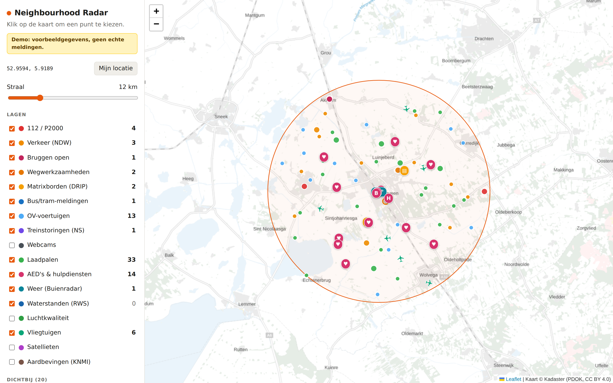

# Neighbourhood Radar

**One map with live open data around a point you choose**: 112/P2000 alerts, road
incidents, open bridges, roadworks, road signs, buses and trains on the move, EV chargers,
AEDs, weather, water levels, air quality, aircraft, satellites and earthquakes. Click the
map, set a radius, and the side panel lists what's happening nearby, nearest first.

-   :material-rocket-launch: **[Run it](install.md)**

    Docker Compose, Podman or a plain Python venv.

-   :material-layers: **[Layers](layers.md)**

    Every data source, where it comes from and how often it refreshes.

-   :material-cog: **[Configuration](configuration.md)**

    Centre, radius, layers and API keys.

-   :material-api: **[API](api.md)**

    The JSON endpoints the map uses.

Inspired by the "KW Live" demo from Kitchener, rebuilt from scratch for the Netherlands with
Dutch open data. It defaults to Heerenveen and the three northern provinces; everything is
configurable. A live demo runs on this project's GitHub Pages site.
