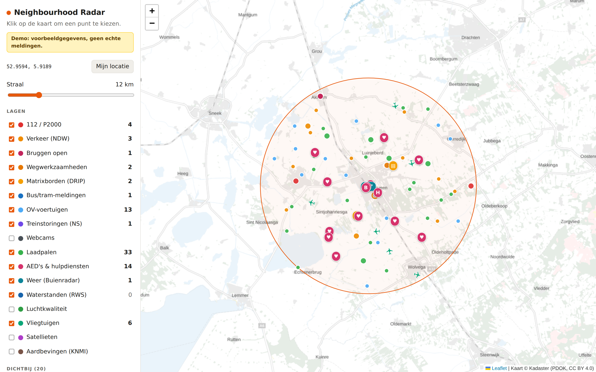
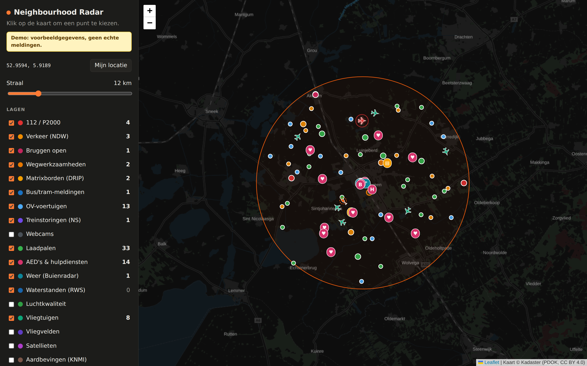
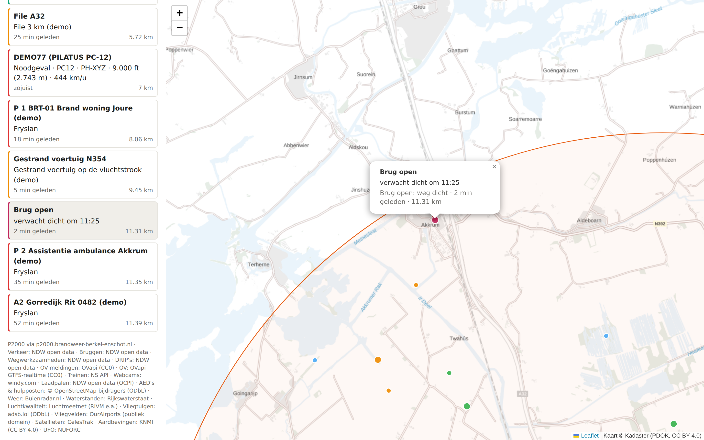
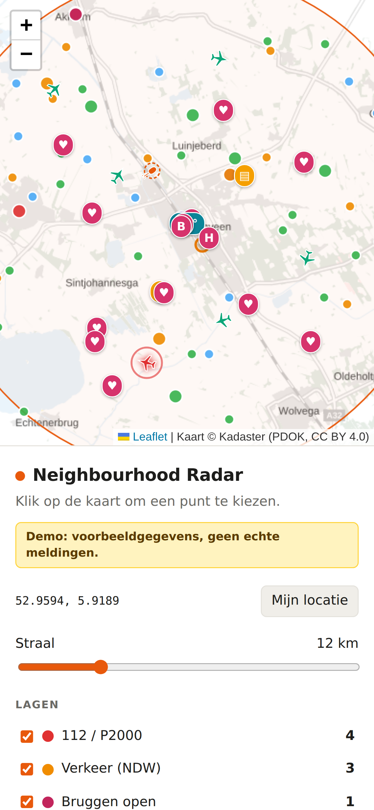

# Screenshots



| Dark mode | Popup | Phone |
|---|---|---|
|  |  |  |

These show **demo mode** with made-up sample data (no real 112 messages). The
screenshots are regenerated by the `screenshots` workflow after every release.

## Try the demo

```bash
docker run --rm -p 8080:8080 -e OL_DEMO=1 ghcr.io/jwklijnsma/neighbourhood-radar:latest
# open http://localhost:8080
```

`OL_DEMO=1` answers every upstream request from built-in sample data, so it
works offline and needs no keys. The page shows a yellow "Demo" banner.

Or open the hosted copy on GitHub Pages: https://jwklijnsma.github.io/neighbourhood-radar/
(see [GitHub Pages](ci.md#github-pages)).
